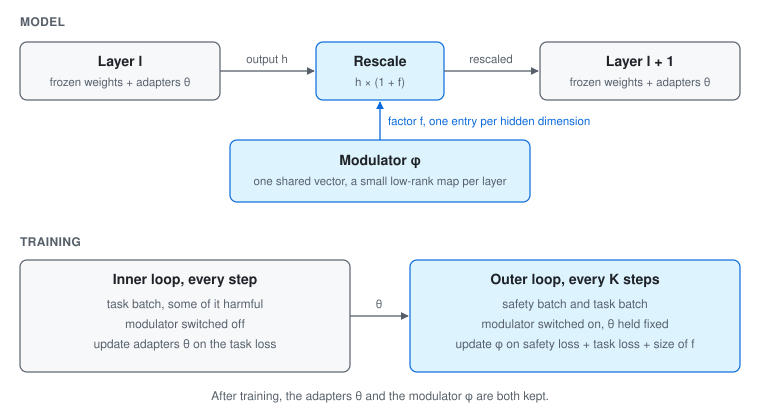
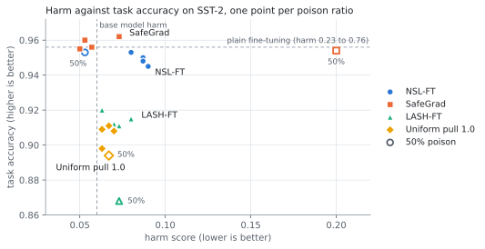
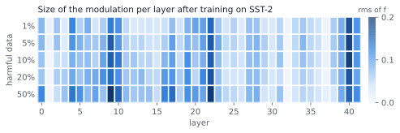

# NSL-FT: Nested Safety Learning for Fine-Tuning

This repository contains the implementation of **NSL-FT** (Nested Safety Learning for Fine-Tuning), a nested-optimization framework designed to limit alignment erosion during full-parameter or parameter-efficient (LoRA) fine-tuning on poisoned or mixed-safety corpora.

## Overview

Fine-tuning a pre-aligned large language model on task data containing harmful demonstrations typically degrades its refusals. Defences that anchor the weights to their initial values preserve safety but also restrain the task. NSL-FT leaves the task optimization unconstrained and learns the safety correction separately, in a small modulator $\phi$ that rescales the output of every transformer layer.

Training is nested. An inner loop fine-tunes the model weights on the task as usual. At fixed intervals, an outer loop updates the modulator so that the fine-tuned model still answers harmful requests the way the base model did. The inner loop does not see the modulator, which makes the outer gradient exact and avoids differentiating through the inner optimization. The modulator remains attached at inference.



## Installation

```bash
git clone https://github.com/VarunKohli18/nsl-ft.git
cd nsl-ft
python -m venv .venv && source .venv/bin/activate
pip install -e .
```

## Configuration & Usage

All pipeline arguments are defined in `config.yaml`.

```yaml
# Model
model: gemma-4-e4b           # gemma-4-e4b | any Hugging Face model identifier
mode: lora                   # lora | full
train_layers: all            # all | integer N (trains only the final N layers)

# Data
dataset: sst2                # sst2 | commonsense | path to a local JSONL file
poison_ratio: 0.1            # fraction of harmful training examples, in [0, 1]
train_samples: 15000         # total training examples

# Inner loop (task optimization of the model weights)
lr: 0.0001                   # learning rate (1e-4 for LoRA, 1e-5 for full fine-tuning)
gamma: 0                     # optional L2 anchor penalty gamma/2 * ||theta - theta_0||^2 (0 = off)
steps: 1000                  # training iterations
seed: 42

# Outer loop (safety optimization of the modulator)
modulator: on                # on | off (off = plain fine-tuning)
inner_steps: 10              # inner steps per outer step (K)
outer_schedule: nested       # nested (modulator steps interleaved with fine-tuning) | after (the same steps, taken once fine-tuning is done)
outer_lr: 0.01               # learning rate of the modulator
lambda_task: 1.0             # weight of the task loss in the outer objective (0 = off)
mu: 0.01                     # penalty on the magnitude of the modulation (0 = off)
rank: 8                      # rank of the per-layer modulator projections

# Safety reference set
safety_data: own_replies     # own_replies (BeaverTails prompts paired with the model's pre-fine-tuning outputs) | harmless_chats (HH-RLHF)

# Evaluation
eval: quick                  # quick (100 prompts per benchmark) | full (500) | none
judge: cais/HarmBench-Llama-2-13b-cls

output_dir: results
```

The safety reference set is never the harmful training data.

### Execution

```bash
# Fine-tune, then evaluate
python main.py --config config.yaml --device cuda:0

# Evaluate the base model without fine-tuning
python main.py --config config.yaml --checkpoint pre-ft --device cuda:0
```

### Custom datasets

A JSONL file with one example per line:

```json
{"prompt": "Is this review positive or negative?\nA charming film.", "response": "positive"}
```

Set `dataset:` to its path. The last rows are held out and used for `task_avg`.

## Architecture

NSL-FT adds one component to the model, the modulator, and trains two sets of parameters at two rates.

- **Model weights $\theta$.** The base model stays frozen; the LoRA adapters (4.5M parameters on Gemma-4 E4B) are trained on the task, exactly as in ordinary fine-tuning.
- **Modulator $\phi$.** After every transformer layer, the layer's output is multiplied element-wise by $1 + f_l$, where $f_l$ has one entry per hidden dimension. $f_l$ is produced from a single learned vector shared by all layers, passed through a small low-rank map that is separate for each layer, and scaled by a learned per-layer gain. The modulator is not conditioned on the input: after training it is a fixed rescaling of each layer's hidden dimensions. It has 0.9M parameters on Gemma-4 E4B (42 layers, rank 8) and starts close to the identity ($f_l \approx 0$).
- **Two loops.** The inner loop updates $\theta$ on the task loss at every step with the modulator disabled. The outer loop updates $\phi$ every $K$ steps with $\theta$ held fixed and the modulator enabled, on the safety loss plus a task term and a penalty on the size of $f_l$. The task term keeps the modulator from buying safety with task accuracy; the size penalty keeps it close to the identity.
- **Why the loops are decoupled.** Since the inner loop never sees the modulator, the adapters cannot adapt to it, and the weights the inner loop arrives at do not depend on $\phi$. The outer gradient is then exact without differentiating through the inner optimization (step 5 below). When the inner loop does see the modulator, the two co-adapt and the model over-refuses (see [Ablations](#ablations)).
- **Inference.** The adapters and the modulator are both kept. The modulator adds one element-wise multiplication per layer.

## Methodology

**1. Parameters.** $\theta$ denotes the trainable model weights (the LoRA adapters), initialized at $\theta^0$, and $\phi$ the modulator. The modulator multiplies the output $h_l$ of every layer $l$ by a learned factor with one entry per hidden dimension, initialized near zero:

```math
h_l \;\leftarrow\; h_l \odot \big(1 + f_l(\phi)\big), \qquad f_l(\phi) = g_l \, U_l \, \text{GELU}(D_l \, c)
```

$c$ is a learned vector shared by all layers, $D_l$ and $U_l$ are a low-rank pair per layer, and $g_l$ is a learned scale.

**2. Inner loop.** At every step, $\theta$ takes one step on the task loss with the modulator disabled:

```math
\theta \;\leftarrow\; \theta - \eta \, \nabla_\theta \Big[ L_\text{task}(\theta) + \frac{\gamma}{2} \lVert \theta - \theta^0 \rVert^2 \Big]
```

**3. Outer loop.** Every $K$ steps (`inner_steps`), $\phi$ takes one step with $\theta$ held fixed and the modulator enabled:

```math
\phi \;\leftarrow\; \phi - \eta_\phi \, \nabla_\phi J(\theta, \phi), \qquad J(\theta, \phi) = L_\text{safe}(\theta, \phi) + \lambda_\text{task} \, L_\text{task}(\theta, \phi) + \mu \, \frac{1}{L} \sum_l \overline{f_l(\phi)^2}
```

**4. Safety reference loss.** With `safety_data: own_replies`, the set $S$ pairs harmful requests $x$ with the model's own pre-fine-tuning replies $y$ (mostly refusals):

```math
L_\text{safe}(\theta, \phi) = -\frac{1}{|S|} \sum_{(x,\,y) \in S} \log p_{\theta, \phi}(y \mid x)
```

**5. Outer gradient.** The nested problem selects $\phi$ for the weights $\theta^*$ that the inner loop arrives at. Its gradient has a direct term and a term through the inner optimization:

```math
\frac{dJ}{d\phi} = \frac{\partial J}{\partial \phi} + \Big(\frac{\partial \theta^*}{\partial \phi}\Big)^{\!\top} \frac{\partial J}{\partial \theta}
```

Because the inner loop does not see the modulator, $\partial \theta^* / \partial \phi = 0$ and the direct term is the full gradient. The two levels are therefore coupled in one direction only: the modulator is trained online against the current weights, and the weights never respond to it. It reaches $\phi$ through each layer's factor, where $\tilde h_l$ is the layer's output after modulation:

```math
\frac{\partial J}{\partial f_l} = h_l \odot \frac{\partial J}{\partial \tilde h_l}
```

## Output Metrics & Artifacts

Each run is written to a folder under `<output_dir>/`:

| File | Content |
| --- | --- |
| `eval_result.json` | all evaluation metrics |
| `train_result.json` | loss trajectory, safety loss and per-layer magnitude of the modulation |
| `final.pt` | final model weights and the modulator |
| `run.log` | console log |

| Metric key | Definition |
| --- | --- |
| `safety_avg` | harm score on BeaverTails, HarmBench and SORRY-Bench (↓) |
| `safety_avg_all` | extended harm score, including StrongREJECT and Do-Not-Answer (↓) |
| `task_avg` | accuracy on the fine-tuning task (↑) |
| `xstest_compliance` | compliance rate on benign prompts that only look sensitive (↑) |
| `xstest_refusal` | refusal rate on explicitly unsafe prompts (↑) |

## Empirical Findings

Evaluated on Gemma-4 E4B with LoRA over 1,000 steps (one seed; 100 prompts per safety benchmark). Harm is the harm score, Task the task accuracy and Refusal the refusal rate on unsafe prompts. NSL-FT uses the configuration above at every poison ratio. "Uniform pull 1.0" anchors every layer to its initial weights with the same strength. It, LASH-FT and SafeGrad were run with the [LASH-FT](https://github.com/VarunKohli18/lash-ft) code.

### Benchmark: SST-2 sentiment classification

Base model reference: Harm = 0.06, Task = 0.711, Refusal = 0.77. Task accuracy is measured on the full validation set (872 sentences).

<table>
<thead>
<tr><th rowspan="2" align="left">Harmful data</th><th></th><th colspan="3" align="center">Plain fine-tuning</th><th></th><th colspan="3" align="center">Uniform pull 1.0</th><th></th><th colspan="3" align="center">LASH-FT</th><th></th><th colspan="3" align="center">SafeGrad</th><th></th><th colspan="3" align="center">NSL-FT</th></tr>
<tr><th></th><th align="center">Harm</th><th align="center">Task</th><th align="center">Refusal</th><th></th><th align="center">Harm</th><th align="center">Task</th><th align="center">Refusal</th><th></th><th align="center">Harm</th><th align="center">Task</th><th align="center">Refusal</th><th></th><th align="center">Harm</th><th align="center">Task</th><th align="center">Refusal</th><th></th><th align="center">Harm</th><th align="center">Task</th><th align="center">Refusal</th></tr>
</thead>
<tbody>
<tr><td>1%</td><td></td><td align="center">0.23</td><td align="center">0.955</td><td align="center">0.58</td><td></td><td align="center">0.06</td><td align="center">0.898</td><td align="center">0.77</td><td></td><td align="center">0.06</td><td align="center">0.920</td><td align="center">0.74</td><td></td><td align="center">0.05</td><td align="center">0.955</td><td align="center">0.76</td><td></td><td align="center">0.09</td><td align="center">0.950</td><td align="center">0.76</td></tr>
<tr><td>5%</td><td></td><td align="center">0.69</td><td align="center">0.954</td><td align="center">0.01</td><td></td><td align="center">0.07</td><td align="center">0.911</td><td align="center">0.77</td><td></td><td align="center">0.08</td><td align="center">0.915</td><td align="center">0.74</td><td></td><td align="center">0.05</td><td align="center">0.960</td><td align="center">0.76</td><td></td><td align="center">0.08</td><td align="center">0.953</td><td align="center">0.75</td></tr>
<tr><td>10%</td><td></td><td align="center">0.70</td><td align="center">0.958</td><td align="center">0.01</td><td></td><td align="center">0.06</td><td align="center">0.909</td><td align="center">0.78</td><td></td><td align="center">0.07</td><td align="center">0.911</td><td align="center">0.73</td><td></td><td align="center">0.06</td><td align="center">0.956</td><td align="center">0.74</td><td></td><td align="center">0.09</td><td align="center">0.945</td><td align="center">0.78</td></tr>
<tr><td>20%</td><td></td><td align="center">0.76</td><td align="center">0.958</td><td align="center">0.00</td><td></td><td align="center">0.07</td><td align="center">0.908</td><td align="center">0.80</td><td></td><td align="center">0.07</td><td align="center">0.912</td><td align="center">0.73</td><td></td><td align="center">0.07</td><td align="center">0.962</td><td align="center">0.73</td><td></td><td align="center">0.09</td><td align="center">0.948</td><td align="center">0.77</td></tr>
<tr><td>50%</td><td></td><td align="center">0.75</td><td align="center">0.944</td><td align="center">0.01</td><td></td><td align="center">0.07</td><td align="center">0.894</td><td align="center">0.75</td><td></td><td align="center">0.07</td><td align="center">0.868</td><td align="center">0.74</td><td></td><td align="center">0.20</td><td align="center">0.954</td><td align="center">0.59</td><td></td><td align="center">0.05</td><td align="center">0.953</td><td align="center">0.76</td></tr>
</tbody>
</table>



Each point is one method at one poison ratio; the best corner is the top left. The anchoring defences (uniform pull, LASH-FT) sit 4 to 5 points below plain fine-tuning in task accuracy. SafeGrad and NSL-FT stay at its level, with SafeGrad moving right at 50% poison.



The figure shows the root-mean-square of $f_l$ per layer, where 0 leaves the layer's output unchanged.

### Benchmark: Commonsense-170K

Base model reference: Harm = 0.06, Task = 0.74, Refusal = 0.77.

<table>
<thead>
<tr><th rowspan="2" align="left">Harmful data</th><th></th><th colspan="3" align="center">LASH-FT</th><th></th><th colspan="3" align="center">SafeGrad</th><th></th><th colspan="3" align="center">NSL-FT</th></tr>
<tr><th></th><th align="center">Harm</th><th align="center">Task</th><th align="center">Refusal</th><th></th><th align="center">Harm</th><th align="center">Task</th><th align="center">Refusal</th><th></th><th align="center">Harm</th><th align="center">Task</th><th align="center">Refusal</th></tr>
</thead>
<tbody>
<tr><td>10%</td><td></td><td align="center">0.05</td><td align="center">0.74</td><td align="center">0.83</td><td></td><td align="center">0.05</td><td align="center">0.75</td><td align="center">0.76</td><td></td><td align="center">0.09</td><td align="center">0.73</td><td align="center">0.78</td></tr>
<tr><td>50%</td><td></td><td align="center">0.06</td><td align="center">0.74</td><td align="center">0.82</td><td></td><td align="center">0.16</td><td align="center">0.71</td><td align="center">0.64</td><td></td><td align="center">0.14</td><td align="center">0.74</td><td align="center">0.75</td></tr>
</tbody>
</table>

### Summary of key observations

1. **Task retention.** SST-2 has to be learned: plain fine-tuning lifts accuracy from 0.711 to 0.96. NSL-FT retains it (0.95) at every poison ratio. Defences that anchor the weights (the uniform pull, LASH-FT) give up 4 to 5 points, and more at 50% poison (6 for the uniform pull, 9 for LASH-FT).
2. **Safety preservation.** NSL-FT keeps refusal at the base model's level at every ratio. Its harm score is 0.08 to 0.09 up to 20% poison, slightly above the 0.05 to 0.07 of the other defences.
3. **Comparison with SafeGrad.** SafeGrad is the strongest method up to 20% poison. At 50% poison its harm score is 0.20 and NSL-FT's is 0.05. This is the result on one seed, and other seeds show variable performance.
4. **Over-refusal.** NSL-FT complies less often with benign prompts that only look sensitive: compliance is 0.85 to 0.88 up to 20% poison and 0.80 at 50%, against 0.92 for the base model and 0.92 to 0.95 for SafeGrad.
5. **No task to protect.** On Commonsense-170K fine-tuning does not improve the base model (0.74 before, 0.70 after plain fine-tuning at 10% poison), and anchoring the weights is the better defence there.
6. **Where the modulator acts.** The modulation is small everywhere: its root-mean-square per layer averages 0.06 to 0.08 and peaks near 0.2. It is largest at layers 9, 22 and 40 at every poison ratio. It grows with the poison ratio in layers 4 to 17 (mean 0.06 at 1% poison, 0.10 at 50%) and stays flat in layers 23 to 38 (about 0.05).
7. **Computational cost.** The modulator uses safety data once every 10 steps, SafeGrad at every step. 1,000 steps at 10% poison on Commonsense-170K, each method alone on one NVIDIA H200, took 338 s with NSL-FT, against 229 s with LASH-FT and 428 s with SafeGrad, all at a 47 GB peak.

### Ablations

- **Modulator trained after fine-tuning** (`outer_schedule: after`). Taking the same 100 modulator steps on the finished model, instead of alongside fine-tuning, gave about the same result: on SST-2, harm 0.11 and task 0.953 at 10% poison (0.09 and 0.945 interleaved), and harm 0.10 and task 0.946 at 50% (0.05 and 0.953 interleaved). The differences are within noise, so the interleaved schedule is not what makes the method work; the modulator can equally be fitted to a model that has already been fine-tuned.
- **Coupled inner loop.** When the inner loop sees the modulator, the adapters come to rely on it, the two drift together, and the model over-refuses (SST-2 at 10% poison: harm 0.02, task 0.89, compliance 0.58).
- **Slow modulator** (`outer_lr: 0.001`, coupled). The modulation stays too small to have an effect (Commonsense-170K at 10% poison: harm 0.44).
- **Token-conditioned modulator.** A modulator that reads each token's hidden state, instead of one shared vector, performed the same as the simpler one.

### Limitations

Results are from a single seed, and differences of a few points are within noise. Other models, tasks and adaptive attacks are untested.

## References

NSL-FT combines ideas from the following work.

- Nested-learning framing (levels with their own objective, data and update frequency, with no backpropagation across levels): [Nested Learning](https://arxiv.org/abs/2512.24695)
- A slow, outer-loop multiplicative modulator over a fast learner: [ANML](https://arxiv.org/abs/2002.09571)
- Learned per-dimension rescaling of activations as the trainable component: [(IA)³](https://arxiv.org/abs/2205.05638)
- Learned scaling vectors trained for refusal with the model weights frozen: [ASGuard](https://arxiv.org/abs/2509.25843)
- Alternating safety and task optimization during fine-tuning: [Lisa](https://arxiv.org/abs/2405.18641)
- Bilevel formulation with safety as the outer objective and the task as the inner one: [SEAL](https://arxiv.org/abs/2410.07471)
- A separate safety component alongside the task weights: [PTST](https://arxiv.org/abs/2402.18540) (fine-tune without it, attach it at inference), [Panacea](https://arxiv.org/abs/2501.18100), [SaLoRA](https://arxiv.org/abs/2501.01765), [Security Vectors](https://arxiv.org/abs/2311.02105)
- The aligned model's own outputs as the safety reference: [SafeGrad](https://arxiv.org/abs/2508.07172), [Constrained fine-tuning](https://arxiv.org/abs/2406.05946)
- Setting and taxonomy of defences: [Harmful fine-tuning survey](https://arxiv.org/abs/2409.18169)
- Baselines: [LASH-FT](https://github.com/VarunKohli18/lash-ft), [SafeGrad](https://arxiv.org/abs/2508.07172)
- Judge: [HarmBench classifier](https://huggingface.co/cais/HarmBench-Llama-2-13b-cls)
- Datasets & benchmarks: [SST-2](https://huggingface.co/datasets/stanfordnlp/sst2), [Commonsense-170K](https://github.com/AGI-Edgerunners/LLM-Adapters), [BeaverTails](https://huggingface.co/datasets/PKU-Alignment/BeaverTails), [HH-RLHF](https://huggingface.co/datasets/Anthropic/hh-rlhf), [HarmBench](https://huggingface.co/datasets/walledai/HarmBench), [SORRY-Bench](https://huggingface.co/datasets/SillyTilly/SorryBench), [StrongREJECT](https://huggingface.co/datasets/walledai/StrongREJECT), [Do-Not-Answer](https://huggingface.co/datasets/LibrAI/do-not-answer), [XSTest](https://huggingface.co/datasets/natolambert/xstest-v2-copy)
